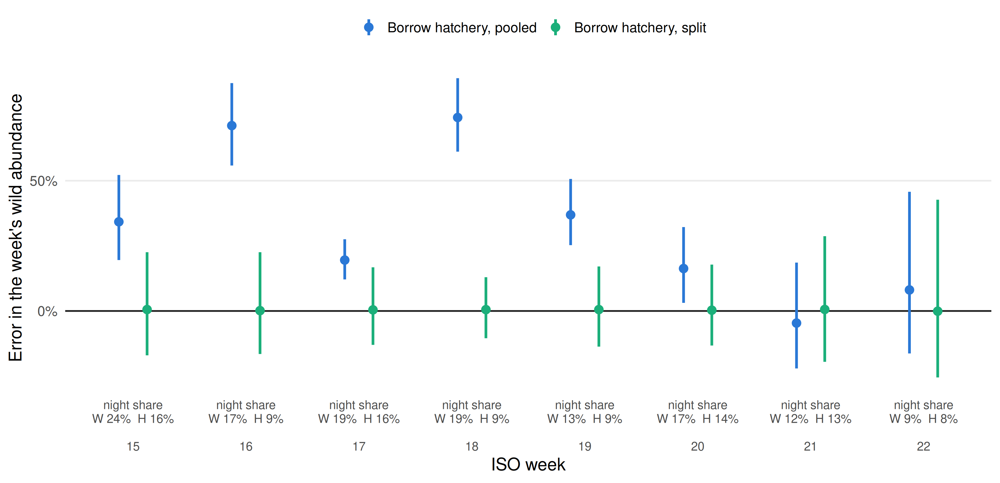

# How Many Fish Are There? Mark-Recapture with JAGS

**First, download and install JAGS:** https://sourceforge.net/projects/mcmc-jags/ (JAGS is a separate program from R; install it before the R packages, then restart R.)

Companion code for the BSU ecological statistics group talk on IDFG mark-recapture, from screw traps to Lower Granite Dam.

**[View the presentation slides](https://docs.google.com/presentation/d/1oUBGKKDx5jiRbfvwGtDFsreYjDw0KO_JpvS4nJRO8xY/edit?slide=id.p19#slide=id.p19)**

Most scripts simulate data from known values, fit a model, and check the answer against the truth. Start at 01 and work up: each step adds one idea.

New to Bayesian statistics? Start with [01_first_bayesian_model.R](01_first_bayesian_model.R), and keep [GLOSSARY.md](GLOSSARY.md) open: it explains the fish terms (GE, GRJ, PIT tag, spill) and the statistics terms (prior, posterior, Rhat, logit) in plain language.

**These are teaching examples, not the models IDFG uses for its estimates.** They are simplified so each idea stands on its own. The concepts carry over to the production models. Written with help from Claude.

**Validation status:** the dam lessons have been revised to use low downstream
recovery throughout. Focused checks cover syntax, diagnostics, arithmetic, and
simulation inputs. Full lesson fits and optional repeated studies need to be
rerun after this revision; the revised JAGS results are not yet validated.
`ANSWERS.md` removes numerical claims that depended on the old high-recovery
scenario. The separate `07a` slide simulation already uses low recovery and
retains its previously checked figure and summaries.

## Requirements

- R (4.0 or later)
- JAGS 4.x, installed separately from R: https://sourceforge.net/projects/mcmc-jags/
- The jagsUI, ggplot2 (>= 3.4.0), and posterior packages: `install.packages(c("jagsUI", "ggplot2", "posterior"))`

On Windows, install JAGS before jagsUI. If R can't find JAGS, restart R after installing it.

Run [00_setup.R](00_setup.R) first. It installs any missing packages, checks that R can find JAGS, fits a tiny test model, and prints your R, JAGS, and package versions. Save that output with your results so the environment can be rebuilt later.

## Quick start

1. Open R or RStudio and run:

   ```r
   getwd()
   ```

   This prints your current working directory. Keep that folder open in File Explorer.

2. Download this repository using **Code → Download ZIP**.

3. Extract the ZIP. Open the extracted `BSUecostats-main` folder, then copy **everything inside it** into the working directory printed by `getwd()`. Keep the `tests` and `figures` subfolders intact. The files `00_setup.R` and `helpers.R` should sit directly in your working directory, not inside another `BSUecostats-main` subfolder. A ZIP file will not appear as a folder in R's working-directory chooser.

4. Check that R can see the setup script, then run it:

   ```r
   file.exists("00_setup.R")  # should print TRUE
   source("00_setup.R")
   ```

   If the check prints `FALSE`, compare `getwd()` with the folder containing `00_setup.R` and move the extracted contents into that folder.

5. Begin with [01_first_bayesian_model.R](01_first_bayesian_model.R). Run one numbered lesson at a time, reading the comments and inspecting the plots.
6. Keep the [glossary](GLOSSARY.md) handy; see [Using This Code](USING_THIS_CODE.md) to adapt an example.

The numbered R scripts and `helpers.R` stay together so they can be run directly from this folder. The helper checks rank-normalized split Rhat (<= 1.01), bulk/tail effective sample sizes (>= 400), and missing diagnostics. These are screening thresholds, not proof of convergence. Inspect trace plots and Monte Carlo error too.

Simulation fits that error or fail diagnostics are retried once and counted if they still fail. Comparisons remain paired. Lesson 07 compares posterior-median abundance expansions because the wild-only inverse-GE mean can be infinite when no guided fish are observed.

Lessons 01 and 03 use the same modern diagnostic helper as the later JAGS
lessons. Traditional jagsUI Rhat is supplemented by rank-normalized split
Rhat and bulk/tail effective sample sizes.

## Building from familiar GLMs

Many Bayesian ecological models connect familiar regressions through shared
parameters and latent processes. Lesson 03 starts with a directly observed
Bernoulli outcome and a logit link. Lesson 05 links intercept-only guidance,
detection, and recovery components through the detection-history likelihood.
Lessons 06 and 07 add covariate, group, and day/night effects. Their component
outcomes are not all observed separately; the histories connect the processes
in one model. This is a useful starting point, not a description of every
Bayesian model.

## Low downstream recovery throughout the dam examples

Recovery here means survival to Little Goose **and detection there**. It is
not survival alone. Lessons 05--07 use the talk's MY2025 wild ratios through
`dam_recovery_defaults()` in `helpers.R`:

| Route at Lower Granite | GOJ recovery used to simulate data |
|---|---:|
| Nonguided (spillway or turbine passage) | 123 / 3,785 = 3.25% |
| Bypassed and returned to river (transport excluded) | 35 / 355 = 9.86% |

Lesson 09 draws nonguided recovery from 1--6% and bypass recovery from 4--15%
in **every** replicate. These are chosen simulation ranges, not uncertainty
intervals from observed data. Lesson 07a already uses 3.25% nonguided recovery.
The data-generating values are low; fitted recovery priors stay broad and are
not truncated to those simulation ranges. With low recovery, zero overlaps,
prior influence, and diagnostic failures are part of the problem to inspect.
Screw-trap efficiency, guidance, and antenna read probability are different
quantities and retain their own simulation settings.

Lesson 06 defaults to an explicitly nonpositive spill-slope prior. Set
`restrict.spill <- FALSE` to allow either direction and compare the same data.
Its new exercise also tests what happens when the true slope is positive but
the fitted prior excludes positive values.

## Levels

- **Start here, no Bayesian background needed:** `01`, `02`, `03`. The basics: prior, likelihood, posterior, MCMC, and the logit.
- **Next steps:** `04`, `05`. State-space and multistate models, conditioning on detection, and identifiability.
- **Graduate level:** `06`, `07`, `08`, `09`. Hierarchical models, borrowing strength, propagating uncertainty, and simulation studies.

## Scripts

| Script | Idea | Talk section |
|---|---|---|
| [00_setup.R](00_setup.R) | Installs packages, checks JAGS, runs a test model, and records versions. | |
| [01_first_bayesian_model.R](01_first_bayesian_model.R) | Prior, likelihood, and posterior for one efficiency trial, solved exactly by hand, then the same model in JAGS. How to read JAGS output, trace plots, Rhat, and credible intervals. | Background for the whole talk |
| [02_lincoln_petersen.R](02_lincoln_petersen.R) | The slide's Bailey example and summing strata, then a separate efficiency-trial simulation with its own +1 correction and Jensen's inequality. Plain R, no JAGS. | Screw traps; Jensen's inequality |
| [03_bernoulli_logit.R](03_bernoulli_logit.R) | A logit GLM in JAGS: each fish is a Bernoulli trial, and spill shifts guidance on the logit scale. | Why model GE on the logit scale |
| [04_state_space_screwtrap.R](04_state_space_screwtrap.R) | A state-space model for daily screw trap passage. Counts alone estimate N × p; adding efficiency trials recovers N. Days with the trap out are estimated anyway. | Screw traps (extension) |
| [05_six_cell.R](05_six_cell.R) | The multistate model at Lower Granite: six detection cells, conditioning on being detected, and a multinomial likelihood. Then two ways it goes wrong: fish tagged after the guidance decision inflate GE, and without a downstream site p and GE can't be separated. | Step 2: The Row Method; Steps 3 and 4; Tagged After Guidance: Not a Fair Sample |
| [06_hierarchical.R](06_hierarchical.R) | Borrowing strength across weeks and rear types. Compares each wild week on its own to the hierarchical fit. | Borrow strength; the hierarchical GE regression |
| [07_day_night.R](07_day_night.R) | Day and night: five cells split by passage time, c5 stays pooled, 11 cells in all. Shows why wild should borrow hatchery's day and night GE, not its pooled GE, when the two pass at night at different rates. | Splitting the cells by day and night; what splitting buys |
| [07a_day_night_closed_form.R](07a_day_night_closed_form.R) | Fast closed-form comparison over 2,000 synthetic seasons calibrated to MY2025 PIT counts, weeks 15–22. Saves the slide figure and its exact numerical summaries. No JAGS. | What Splitting Buys: A Simulation With Known Truth |
| [08_bootstrap.R](08_bootstrap.R) | The slide's one-day fixed-GE bootstrap, then weekly fixed GE versus GE draws. Coverage of each over 300 simulated weeks. Plain R, no JAGS. | Where Bootstrap Intervals Come From; Jensen's inequality |
| [09_recover_truth.R](09_recover_truth.R) | A small simulation study: bias and 95% interval coverage over 50 simulated data sets. | Does it recover GE? |

Every lesson script runs top to bottom and prints its results and a plot. Scripts that use JAGS write their models to `.jags` files in the working directory. Plain-R examples are quick; JAGS fits and repeated studies can take minutes or longer. Low-recovery runtimes and diagnostics need rechecking, especially in `05`, `06`, `07`, and `09`. In `06` and `07`, single-example and model-check/prior-sensitivity sections run by default. Repeated simulation studies are off: set `run.repeats <- TRUE` at the top of either script to add them.

## Real data to try

The scripts use simulated data, but the same kinds of data are public:

- **PIT tag detections:** PTAGIS, https://www.ptagis.org/
- **River flow and spill at the dams:** Fish Passage Center historical flow and spill query, https://www.fpc.org/smolt/smolt_queries/Q_river_historicflowspill_dataquery.php

[USING_THIS_CODE.md](USING_THIS_CODE.md) explains how to turn fish-level detection records into the cell counts the models need.

## What to read alongside

Kéry, M., and M. Schaub. 2012. *Bayesian Population Analysis using WinBUGS: A Hierarchical Perspective.* Academic Press. The book's code was written for WinBUGS; the authors also provide a translation that runs in JAGS through jagsUI: [BPA code with jagsUI](https://www.vogelwarte.ch/wp-content/uploads/2025/01/BPA-with-jagsUI-Kopie.txt).

Each script ends with a `Where BPA teaches this` section pointing to the matching book sections.

- Chapter 1: the binomial observation process, and why simulate (scripts 02, 09)
- Chapter 2: Bayes rule, priors, posteriors, MCMC, and convergence (script 01)
- Chapter 3: GLMs, link functions, and the logit (scripts 03, 06)
- Chapter 4: random effects (script 06)
- Chapter 5: state-space models for counts (script 04)
- Chapter 6: closed-population size from capture-recapture (script 02)
- Chapter 7: time and group effects, identifiability, and the multinomial likelihood (scripts 05, 06, 09)
- Chapter 9: multistate models (scripts 05, 07)

See [USING_THIS_CODE.md](USING_THIS_CODE.md) for how to adapt these models to your own data, including how to format raw detection histories into the arrays the models need, and a list of gotchas that bite real studies.

**Before using any adapted model on real data, run it through [09_recover_truth.R](09_recover_truth.R).** It's a template, not just an exercise: if a model can't recover known values from simulated data, it won't recover unknown ones from yours.

## Regression checks

After setup, run `Rscript tests/audit_checks.R` from the repository root. These focused checks cover diagnostic failures, detection-history validation, and the finite median used for inverse-GE expansion. They do not replace running the lessons or the optional repeated simulation studies.

Run `Rscript tests/talk_examples.R` for the slide arithmetic and
`Rscript tests/day_night_closed_form.R` for the closed-form day/night example.
Both use base R only.

`Rscript tests/low_recovery.R` checks recovery ranges and route contrasts without
fitting JAGS models. These checks do not substitute for full lesson runs.

## Reproduce the day/night slide figure

Run from the repository root:

```r
source("07a_day_night_closed_form.R")
```

Or use `Rscript 07a_day_night_closed_form.R`. This example requires only
ggplot2 >= 3.4.0 and saves `figures/day_night_borrowing.png` (300 dpi), a vector
SVG, weekly/season summary CSVs, failure diagnostics, and software versions.
The PNG and summary CSVs are included here; rerunning regenerates them from
the same code, seed, and explicit RNG algorithms.



Observed counts calibrate a synthetic experiment; they are not known true
guidance probabilities. Both rears are deliberately assigned the same day
GE, night GE, detection, and recovery; only timing differs. Borrowing is
complete in this example, whereas lesson 06 demonstrates partial pooling.
Recovery is a fixed simulation input. Error isolates GE borrowing, holding
expected catch fixed. Synthetic tagged-arrival counts supply season weights,
not measured whole-run abundance. Points are medians and bars the middle 90%
of errors across simulations, not posterior intervals from one analysis.

When overlap counts cannot identify detection, the estimator reports a failure
instead of substituting the known simulation probability. Weekly comparisons
remain paired, and a season total is retained only when all eight weeks are
valid. The output reports these exclusions; error summaries describe the
successful pairs. The production model and its multiyear validation are separate.

With seed 2025, 1,997 of 2,000 seasons have all eight weeks estimable. Three
wild week-15 tables have no GRS–GOJ overlap. The generated slide numbers are:

| Method | Median season error | Middle 90% of successful season errors |
|---|---:|---:|
| Borrow hatchery, pooled | +33.3% | +26.8% to +40.6% |
| Borrow hatchery, split | +1.3% | -5.8% to +9.1% |

Caption: **Points show median weekly error; bars span the middle 90% of
simulated errors. 2,000 synthetic seasons calibrated to MY2025 PIT counts;
summaries use successful pairs.** Night-share labels are the imposed
simulation inputs, not re-estimates from each simulated season.

## Matching the talk examples

Use slide titles because slide numbers change as the deck develops.

| Talk topic | Companion example and scope |
|---|---|
| We Control the Marks | `02`, section 0: Bailey's 9,533 example and sum across strata. The following independent-trial simulation uses a different correction. |
| Where Bootstrap Intervals Come From | `08`, section 0: 130 caught, sample rate 0.25, GE 0.13, 2,000 replicates, 90% interval. The slide's 3,446–4,554 endpoints are from a particular simulation; without its RNG state, the new run need not match them. Exact binomial endpoints round to 3,446–4,585. |
| Step 2: The Row Method | `05`, section 0: three rows with read probabilities 0.64, 0.61, 0.53 and a combined 0.934012. Row overlaps illustrate estimation under independent, equally readable fish. |
| Most of the PIT Fish Are Hatchery | `06`, section 1b: an illustrative adjacent-week pooling rule requiring both c4+c5 > 10 and c3+c4 > 10, with a trailing group merged backward. The fitted simulation retains its fixed teaching strata. |
| Simpson's Paradox | `07`, section 0: the toy reversal from 0.066 to 0.112. |
| What Splitting Buys: A Simulation With Known Truth | `07a`: the eight-week, 2,000-season closed-form simulation. Use its generated PNG and season CSV together so the plot and slide numbers match. Failures are counted explicitly. |
| Lessons for Your Own Models: transport flags | `05`, section 9: missing flags leave GE unchanged but drag bypass recovery down, because barged fish look like bypassed fish that never reached GOJ. |

The talk's regression includes outflow; `06` uses spill only. The talk's day/night model extends that regression; `07` uses one week without covariates. The talk carries genetic stock-assignment uncertainty; `08` leaves it out along with composition resampling.

Each lesson (`01`–`09`) ends with **Try this** exercises just before its lessons summary. Predict the result, change one setting, rerun, and inspect diagnostics before interpreting it. Reset the change before trying the next exercise. [ANSWERS.md](ANSWERS.md) provides guidance and labels historical numerical examples. Numerical answers for the revised low-recovery JAGS lessons await fresh runs.

Lesson `05`, section 3b, walks through the talk's MY2025 wild counts with plain division before introducing the multinomial: naive GE, a row-read correction, then the GOJ overlap correction. These season calculations are kept separate from the simulated JAGS data and from the production hierarchical estimates.
