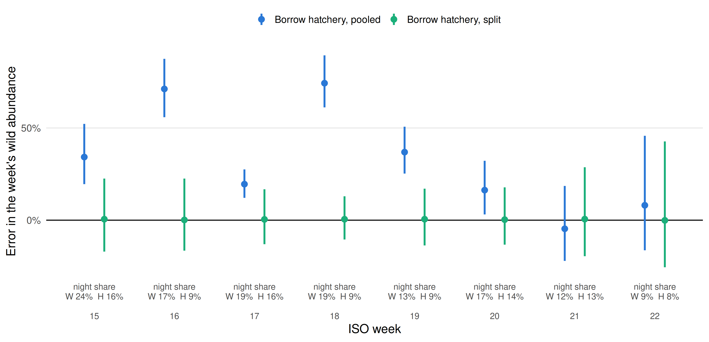

# Matching the Talk

Which script reproduces each slide, and the simulation settings behind the dam examples. Use slide titles because slide numbers change as the deck develops.

## Slide-by-slide

| Talk topic | Companion example and scope |
|---|---|
| We Control the Marks | `02`, section 0: Bailey's 9,533 example and sum across strata. The following independent-trial simulation uses a different correction. |
| Where Bootstrap Intervals Come From | `08`, section 0: 130 caught, sample rate 0.25, GE 0.13, 2,000 replicates, 90% interval. The seed-7 simulation gives 3,445–4,585; exact binomial endpoints round to 3,446–4,585. Use one of these documented versions on the slide. |
| Step 2: The Row Method | `05`, section 0: three rows with read probabilities 0.64, 0.61, 0.53 and a combined 0.934012. Row overlaps illustrate estimation under independent, equally readable fish. |
| Most of the PIT Fish Are Hatchery | `06`, section 1b: an illustrative adjacent-week pooling rule requiring both c4+c5 > 10 and c3+c4 > 10, with a trailing group merged backward. The fitted simulation retains its fixed teaching strata. |
| Simpson's Paradox | `07`, section 0: the toy reversal from 0.066 to 0.112. |
| What Splitting Buys: A Simulation With Known Truth | `07a`: the eight-week, 2,000-season closed-form simulation. Use its generated PNG and season CSV together so the plot and slide numbers match. Failures are counted explicitly. |
| Lessons for Your Own Models: transport flags | `05`, section 9: missing flags leave GE unchanged but drag bypass recovery down, because barged fish look like bypassed fish that never reached GOJ. |

`05`, section 3b, walks through the talk's MY2025 wild counts with plain division before the multinomial: naive GE, a row-read correction, then the GOJ overlap correction (0.12 → 0.11 → 0.05). These season calculations are kept separate from the simulated JAGS data and from the production hierarchical estimates.

The talk's regression includes outflow; `06` uses spill only. The talk's day/night model extends that regression; `07` uses one week without covariates. The talk carries genetic stock-assignment uncertainty; `08` leaves it out along with composition resampling.

## Low downstream recovery in the dam examples

Recovery here means survival to Little Goose **and detection there**. It is not survival alone. Lessons 05–07 use the talk's MY2025 wild ratios through `dam_recovery_defaults()` in `helpers.R`:

| Route at Lower Granite | GOJ recovery used to simulate data |
|---|---:|
| Nonguided (spillway or turbine passage) | 123 / 3,785 = 3.25% |
| Bypassed and returned to river (transport excluded) | 35 / 355 = 9.86% |

Lesson 09 draws nonguided recovery from 1–6% and bypass recovery from 4–15% in every replicate. These are chosen simulation ranges, not uncertainty intervals from observed data. Lesson 07a also uses 3.25% nonguided recovery. Fitted recovery priors stay broad and are not truncated to those ranges. With low recovery, zero overlaps, prior influence, and diagnostic failures are part of the problem to inspect. Screw-trap efficiency, guidance, and antenna read probability keep their own simulation settings.

## The day/night slide figure

Run from the repository root:

```r
source("07a_day_night_closed_form.R")
```

Or use `Rscript 07a_day_night_closed_form.R`. This example requires only ggplot2 >= 3.4.0 and saves `figures/day_night_borrowing.png` (300 dpi), a vector SVG, weekly and season summary CSVs, failure diagnostics, and software versions. Rerunning regenerates them from the same code, seed, and explicit RNG algorithms.



Observed counts calibrate a synthetic experiment; they are not known true guidance probabilities. Both rears are deliberately assigned the same day GE, night GE, detection, and recovery; only timing differs. Borrowing is complete in this example, whereas lesson 06 demonstrates partial pooling. Recovery is a fixed simulation input. Error isolates GE borrowing, holding expected catch fixed. Synthetic tagged-arrival counts supply season weights, not measured whole-run abundance. Points are medians and bars the middle 90% of errors across simulations, not posterior intervals from one analysis.

When overlap counts cannot identify detection, the estimator reports a failure instead of substituting the known simulation probability. Weekly comparisons remain paired, and a season total is retained only when all eight weeks are valid. The production model and its multiyear validation are separate.

With seed 2025, 1,997 of 2,000 seasons have all eight weeks estimable. Three wild week-15 tables have no GRS–GOJ overlap. The generated slide numbers are:

| Method | Median season error | Middle 90% of successful season errors |
|---|---:|---:|
| Borrow hatchery, pooled | +33.3% | +26.8% to +40.6% |
| Borrow hatchery, split | +1.3% | -5.8% to +9.1% |

Caption: **Points show median weekly error; bars span the middle 90% of simulated errors. 2,000 synthetic seasons calibrated to MY2025 PIT counts; summaries use successful pairs.** Night-share labels are the imposed simulation inputs, not re-estimates from each simulated season.
